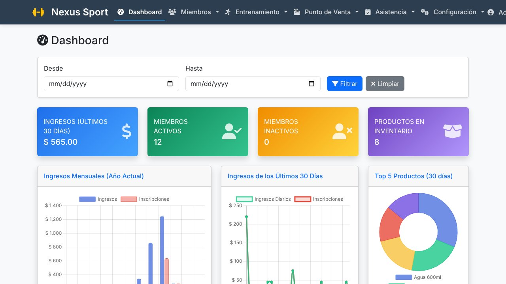
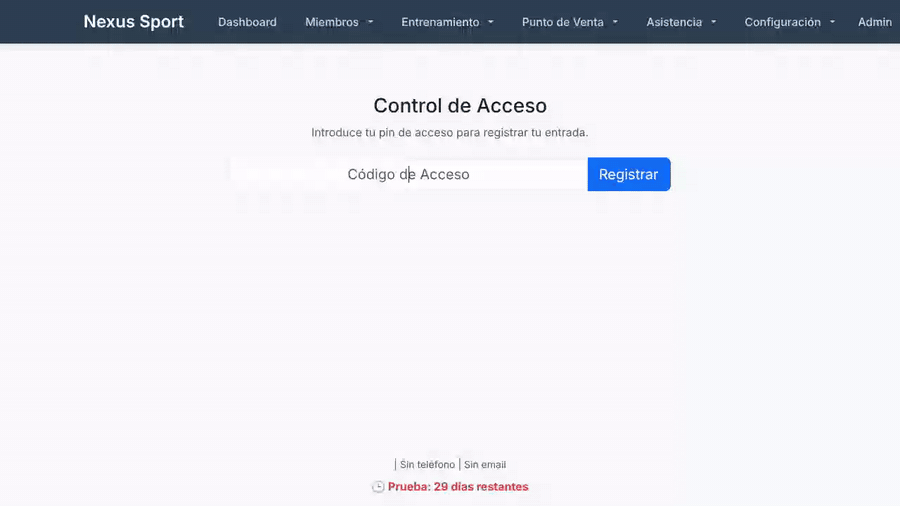
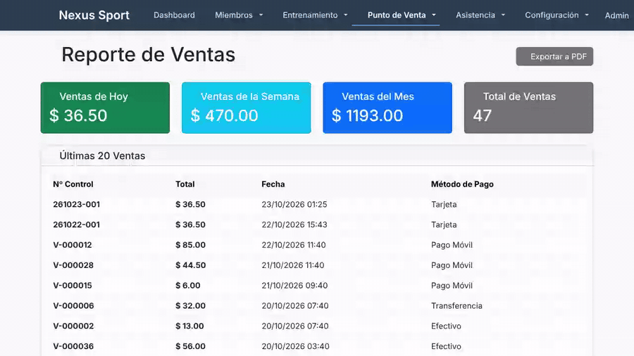

# 🏋️ Nexus Sport — Gym Manager

Software de gestión para gimnasios en Windows: miembros, membresías, punto de venta, rutinas, asistencia y reportes en una sola aplicación.

🌐 **Página del proyecto:** https://TU_USUARIO.github.io/TU_REPO/
⬇️ **Descarga:** [Releases](https://github.com/TU_USUARIO/TU_REPO/releases)

## ✨ Características

- **Miembros y pagos:** perfiles, vencimientos, historial de pagos y progreso físico.
- **Punto de venta:** carrito, métodos de pago, tickets e inventario.
- **Rutinas y calendario:** biblioteca de ejercicios, rutinas y entrenamientos programados.
- **Control de acceso:** registro de entrada por código e historial de asistencia.
- **Reportes:** ventas, inventario, ingresos mensuales y caja chica.
- **Multimoneda:** USD, bolívares y tasas de cambio configurables.
- **Administración:** usuarios, membresías, bancos, monedas y datos del gimnasio.

## 🎬 Demo

| Login y dashboard | Miembros |
|---|---|
|  |  |
| **Punto de venta** | **Entrenamiento** |
|  |  |
| **Asistencia** | **Reportes** |
|  |  |

> Las grabaciones usan datos de ejemplo ficticios.

## 🚀 Instalación

1. Descarga `GymManager.exe` desde [Releases](https://github.com/TU_USUARIO/TU_REPO/releases).
2. Ejecútalo. Se abrirá en tu navegador y creará la base de datos local.
3. Inicia sesión con el usuario inicial (ver `initial_admin_credentials.txt`, generado en el primer arranque).
4. **Cambia la contraseña de inmediato y elimina ese archivo.**

## 🛠️ Tecnologías

Python 3.13 · Flask · SQLAlchemy (SQLite) · Flask-Login · Flask-WTF · Bootstrap 5 · Chart.js · DataTables · FullCalendar · PyInstaller

## 📝 Notas

- Los datos se guardan localmente en la carpeta `instance/` junto al ejecutable.
- Algunos componentes visuales (gráficos y tablas) se cargan desde CDN y requieren internet.

## 📄 Licencia y contacto

© 2025 Germanpet. Todos los derechos reservados.
Versión 1.0 · Soporte: germanpet@gmail.com
